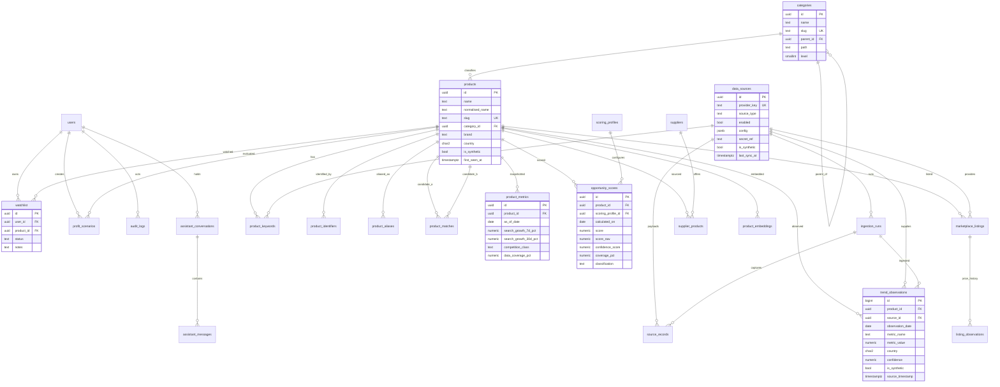

# 02 — Database Design and ERD

**Database:** PostgreSQL 16
**Status:** Proposed schema. Migration order at §8.
**Companion:** [`01-architecture.md`](01-architecture.md) §7–§10 for the rules these tables support.

---

## 1. Design principles

1. **Observations and derived values are separate.** Raw provider measurements live in
   `trend_observations` (the system of record). Anything computed by us lives in `product_metrics`
   and `opportunity_scores`, each keyed by a date so history is retained (PRD §7, §8).
2. **Never lose evidence.** Scores, audit logs, health checks and provider snapshots are insert-only.
   Observation rows are keyed by their natural key; re-ingestion is idempotent, and a changed
   provider value updates the current row while incrementing `revision` and retaining up to five
   prior values. The immutable `provider_snapshots` payload preserves the full earlier evidence.
   Only mutable catalogue metadata (`products`, `categories`, `suppliers`) is otherwise updated in
   place.
3. **Every fact has provenance.** Observations carry `source_id`, `source_timestamp`, `ingested_at`,
   `confidence` and `is_synthetic`. Scores carry the profile version and coverage that produced them.
4. **Absence is explicit.** Numeric nullable columns are paired with a reason code column. A missing
   growth value is never stored as `0`.
5. **Identity is explicit.** Products are matched on identifiers and aliases, not names. Merges are
   recorded, never destructive.
6. **UUIDv7 primary keys** for domain tables (time-ordered, index-friendly); `BIGSERIAL` for
   high-volume log tables (`trend_observations`, `audit_logs`, `provider_health_checks`,
   price observations).
7. **Money** is `NUMERIC(12,2)` with an ISO-4217 `currency` beside it. Never float.
8. **Time** is `timestamptz`, stored UTC. `DATE` is used for daily observation/snapshot keys.

---

## 2. ERD



The full column list, constraints and indexes follow. Tables are grouped by concern.

---

## 3. Identity and catalogue

### 3.1 `users`

| Column | Type | Constraints |
|---|---|---|
| `id` | uuid | PK, default `uuidv7()` |
| `email` | citext | NOT NULL, UNIQUE |
| `password_hash` | text | NOT NULL (Argon2id) |
| `display_name` | text | |
| `role` | user_role | NOT NULL, default `analyst` |
| `is_active` | boolean | NOT NULL, default true |
| `last_login_at` | timestamptz | |
| `created_at` / `updated_at` | timestamptz | NOT NULL, default now() |

`user_role`: `admin | analyst | viewer`.

### 3.2 `auth_refresh_tokens`

| Column | Type | Notes |
|---|---|---|
| `id` | uuid | PK |
| `user_id` | uuid | FK → users, ON DELETE CASCADE |
| `token_hash` | text | UNIQUE, NOT NULL — SHA-256 of the opaque token |
| `expires_at` | timestamptz | NOT NULL |
| `revoked_at` | timestamptz | |
| `replaced_by_id` | uuid | FK → self (rotation chain) |
| `user_agent`, `ip` | text, inet | |

Index: `(user_id, expires_at DESC)`; partial index on active tokens.

### 3.3 `categories`

| Column | Type | Constraints |
|---|---|---|
| `id` | uuid | PK |
| `name` | text | NOT NULL |
| `slug` | text | NOT NULL, UNIQUE |
| `parent_id` | uuid | FK → categories, ON DELETE RESTRICT |
| `path` | text | NOT NULL, e.g. `home-kitchen/kitchen-storage` |
| `level` | smallint | NOT NULL, 0 = root |
| `is_active` | boolean | NOT NULL, default true |
| `created_at` / `updated_at` | timestamptz | |

Constraints: `UNIQUE (parent_id, lower(name)) NULLS NOT DISTINCT` (PG15+, prevents duplicate roots);
`CHECK (level >= 0)`; trigger (or service-level guard) prevents cycles and enforces
`path = parent.path || '/' || slug`.

Indexes: `(parent_id)`, `(path text_pattern_ops)` for subtree prefix queries.

Seeded with the 16 PRD categories (§4.1) plus subcategories; the tree is data, not code.

### 3.4 `products`

| Column | Type | Constraints |
|---|---|---|
| `id` | uuid | PK |
| `name` | text | NOT NULL — canonical display name |
| `normalised_name` | text | NOT NULL — lower, punctuation-stripped, stopword-free |
| `slug` | text | NOT NULL, UNIQUE |
| `description` | text | |
| `category_id` | uuid | FK → categories, ON DELETE SET NULL |
| `brand` | text | |
| `model` | text | |
| `image_url` | text | |
| `country` | char(2) | NOT NULL default `AU` — the market the product is evaluated in |
| `currency` | char(3) | NOT NULL default `AUD` |
| `attributes` | jsonb | NOT NULL default `'{}'` — size/colour/material/variants |
| `status` | product_status | NOT NULL default `active` |
| `is_manual` | boolean | NOT NULL default false |
| `is_synthetic` | boolean | NOT NULL default false |
| `merged_into_product_id` | uuid | FK → products, NULL unless merged |
| `primary_source_id` | uuid | FK → data_sources, NULL for manual |
| `first_seen_at` | timestamptz | NOT NULL |
| `last_seen_at` | timestamptz | |
| `created_at` / `updated_at` | timestamptz | NOT NULL |

`product_status`: `discovered | active | archived | merged`.
`CHECK (merged_into_product_id IS NULL OR status = 'merged')`.

Indexes: `(category_id)`, `(status, country)`, GIN trigram on `name` and `normalised_name`
(`pg_trgm`), `(normalised_name)`, `(brand)`.

### 3.5 `product_identifiers`

Deterministic dedup keys (PRD §4.1).

| Column | Type | Constraints |
|---|---|---|
| `id` | uuid | PK |
| `product_id` | uuid | FK → products, ON DELETE CASCADE |
| `scheme` | identifier_scheme | NOT NULL |
| `value` | text | NOT NULL |
| `source_id` | uuid | FK → data_sources, NULL |
| `created_at` | timestamptz | |

`identifier_scheme`: `gtin | upc | ean | isbn | asin | ebay_item | supplier_sku | mpn | shopify_sku`.
**`UNIQUE (scheme, value)`** — one product per real-world identifier. Index `(product_id)`.

### 3.6 `product_aliases`

Alternate names observed at sources, used by the matcher.

| Column | Type | Constraints |
|---|---|---|
| `id` | uuid | PK |
| `product_id` | uuid | FK → products, ON DELETE CASCADE |
| `alias` | text | NOT NULL |
| `normalised_alias` | text | NOT NULL |
| `source_id` | uuid | FK → data_sources, NULL |
| `created_at` | timestamptz | |

`UNIQUE (product_id, normalised_alias)`. Index `(normalised_alias)`.

### 3.7 `product_matches` (merge review queue)

| Column | Type | Constraints |
|---|---|---|
| `id` | uuid | PK |
| `product_a_id` | uuid | FK → products, NOT NULL |
| `product_b_id` | uuid | FK → products, NOT NULL |
| `method` | match_method | `identifier | alias | name_exact | fuzzy | embedding |
| `similarity` | numeric(4,3) | 0–1 |
| `status` | match_status | `pending | merged | rejected`, default `pending` |
| `reviewed_by` | uuid | FK → users |
| `reviewed_at` | timestamptz | |
| `created_at` | timestamptz | |

Constraints: `CHECK (product_a_id < product_b_id)` (canonical ordering, prevents duplicate pairs);
`UNIQUE (product_a_id, product_b_id)`. Index `(status)` partial where status = 'pending'.

### 3.8 `product_keywords`

| Column | Type | Constraints |
|---|---|---|
| `id` | uuid | PK |
| `product_id` | uuid | FK → products, ON DELETE CASCADE |
| `keyword` | text | NOT NULL |
| `normalised_keyword` | text | NOT NULL |
| `source_id` | uuid | FK → data_sources, NULL |
| `weight` | numeric(5,4) | optional relevance |
| `country` | char(2) | default `AU` |
| `created_at` | timestamptz | |

`UNIQUE (product_id, normalised_keyword, source_id) NULLS NOT DISTINCT`.
Index: GIN trigram on `normalised_keyword` — powers keyword search in the explorer.

### 3.9 `product_embeddings` (optional, Phase 2+)

`id`, `product_id` FK UNIQUE, `model` text, `embedding vector(1536)`, `created_at`.
Only created when `ENABLE_PGVECTOR=true`; guarded by a migration that requires the extension.

---

## 4. Sources and ingestion

### 4.1 `data_sources`

| Column | Type | Constraints |
|---|---|---|
| `id` | uuid | PK |
| `provider_key` | text | NOT NULL, UNIQUE (`google_trends`, `ebay_au`, …) |
| `provider_name` | text | NOT NULL |
| `source_type` | source_type | NOT NULL |
| `enabled` | boolean | NOT NULL default false |
| `config` | jsonb | NOT NULL default `'{}'` — **non-secret only** |
| `secret_ref` | text | env var *names*, e.g. `"DATAFORSEO_LOGIN,DATAFORSEO_PASSWORD"` |
| `is_synthetic` | boolean | NOT NULL default false |
| `rate_limit_per_min` | integer | default per provider |
| `cost_model` | text | `free | paid | manual | synthetic` |
| `monthly_cost` | numeric(12,2) | declared subscription cost, default 0 |
| `cost_currency` | char(3) | default `AUD` |
| `request_limit_month` | integer | NULL = no declared cap |
| `requests_used_month` | integer | NOT NULL default 0 |
| `usage_period` | text | `YYYY-MM` the usage count belongs to |
| `availability` | text | `available | requires_credentials | manual_fallback | unavailable` |
| `availability_reason` | text | operator-readable explanation |
| `usage_rights` | text | what the connector may do with the data |
| `docs_url` / `terms_url` | text | provider references |
| `last_success_at` | timestamptz | last successful collection |
| `last_sync_at` | timestamptz | |
| `sync_status` | sync_status | `never_run | ok | partial | error | disabled | degraded` |
| `last_error` | text | redacted, truncated |
| `consecutive_failures` | integer | NOT NULL default 0 (circuit breaker) |
| `health_status` | text | `healthy | degraded | unavailable | unconfigured | manual | unknown` |
| `last_health_check_at` | timestamptz | latest health check |
| `last_health_latency_ms` | integer | provider round-trip for the latest check |
| `created_at` / `updated_at` | timestamptz | |

`source_type`: `search_trend | marketplace | social | supplier | emerging | manual | demo`.
**Invariant:** no column in this table ever holds a credential value. Enforced by a service-level
allow-list of `config` keys per provider and by a review checklist.

### 4.2 `ingestion_runs`

| Column | Type | Notes |
|---|---|---|
| `id` | uuid | PK |
| `source_id` | uuid | FK, NOT NULL |
| `job_name` | text | e.g. `sync.google_trends.daily` |
| `status` | run_status | `running | success | partial | failed` |
| `started_at` | timestamptz | NOT NULL |
| `finished_at` | timestamptz | |
| `records_fetched` | integer | default 0 |
| `records_written` | integer | default 0 |
| `records_updated` | integer | observations revised in place; default 0 |
| `records_rejected` | integer | default 0 |
| `error_count` | integer | default 0 |
| `cursor` | jsonb | provider cursor/ETag for incremental sync |
| `error_summary` | text | first N errors, redacted |
| `celery_task_id` | text | correlation |
| `request_id` | text | |

Indexes: `(source_id, started_at DESC)`, `(status)` partial where status IN ('running','failed').

### 4.3 `trend_observations` (system of record, keyed by natural key)

| Column | Type | Constraints |
|---|---|---|
| `id` | bigint | PK, identity |
| `product_id` | uuid | FK → products, NOT NULL |
| `source_id` | uuid | FK → data_sources, NOT NULL |
| `ingestion_run_id` | uuid | FK → ingestion_runs |
| `observation_date` | date | NOT NULL — the day the metric describes |
| `granularity` | granularity | `daily | weekly | monthly`, default `daily` |
| `metric_name` | metric_name | NOT NULL (see below) |
| `metric_type` | text | `search_interest | marketplace_price | marketplace_competition | social_engagement | advertising | actual_sales | estimated_sales | supplier_cost | other` — never merged across types |
| `metric_value` | numeric(20,6) | NOT NULL |
| `unit` | text | `index_0_100 | count | aud | rank | score | pct` |
| `country` | char(2) | NOT NULL |
| `currency` | char(3) | NULL for non-monetary metrics |
| `provider_name` | text | named provider or manual method |
| `period_start` / `period_end` | date | period the measurement covers |
| `source_url` | text | where the operator/provider obtained it |
| `verification_status` | text | `verified | estimated | unverified | synthetic` |
| `data_quality` | text | `high | medium | low | unknown | synthetic` |
| `original_metric` | text | the provider's own metric name |
| `confidence` | numeric(4,3) | 0–1, NOT NULL default 1.0 |
| `is_synthetic` | boolean | NOT NULL default false — denormalised for filtering |
| `source_timestamp` | timestamptz | when the provider says it was measured |
| `collected_at` | timestamptz | when the observation entered TrendScope |
| `ingested_at` | timestamptz | NOT NULL default now() |
| `revision` | integer | NOT NULL default 1 — increments when a provider revises the value |
| `updated_at` | timestamptz | when the current revision replaced the prior value |
| `metadata` | jsonb | NOT NULL default `'{}'` — related query, region, listing id, prior values, etc. |

`metric_name`: `search_interest | search_interest_region | related_query_interest |
marketplace_listing_count | marketplace_avg_price | marketplace_best_seller_rank |
marketplace_review_count | marketplace_review_velocity | social_engagement_score |
social_hashtag_views | supplier_price | supplier_moq | supplier_availability`.

**`UNIQUE (product_id, source_id, observation_date, metric_name, granularity, country)`** — the
idempotency key. Re-ingesting a day updates that point; it never creates a duplicate series point and
never deletes an earlier date.

Indexes: `(product_id, metric_name, observation_date DESC)` — the chart and metric-query path;
`(source_id, observation_date)`; `(observation_date, is_synthetic)` for maintenance.
Partitioning by month is a later optimisation; not needed at MVP scale.

**Retention:** observations are never deleted by default. `source_records` (raw payload) are pruned
after 90 days by a maintenance job.

### 4.4 `source_records` (raw payload audit, optional retention)

| Column | Type | Notes |
|---|---|---|
| `id` | bigint | PK |
| `source_id` | uuid | FK |
| `ingestion_run_id` | uuid | FK |
| `external_id` | text | provider id |
| `payload` | jsonb | truncated if > 1 MB |
| `fetched_at` | timestamptz | |
| `expires_at` | timestamptz | default `fetched_at + 90 days` |

Indexes: `(source_id, fetched_at DESC)`, `(expires_at)` for the purge job. Used to debug a connector
or replay an ingestion; not read on any product path.

### 4.5 `provider_health_checks` (append-only)

| Column | Type | Notes |
|---|---|---|
| `id` | uuid | PK |
| `source_id` | uuid | FK → data_sources, ON DELETE CASCADE |
| `checked_at` | timestamptz | NOT NULL |
| `live` | boolean | false for a local configuration check |
| `status` | text | `healthy | degraded | unavailable | unconfigured | manual` |
| `ok` | boolean | |
| `latency_ms` / `http_status` | integer | provider round-trip evidence when live |
| `message` | text | redacted, truncated |
| `details` | jsonb | credential names, state, probe-specific safe details |

Index: `(source_id, checked_at DESC)`. Health checks are never updated or deleted by ingestion;
this is what makes a flapping provider and a recovered credential failure visible.

### 4.6 `provider_snapshots` (append-only payload archive)

| Column | Type | Notes |
|---|---|---|
| `id` | uuid | PK |
| `source_id` | uuid | FK → data_sources, ON DELETE CASCADE |
| `ingestion_run_id` | uuid | FK → ingestion_runs, ON DELETE SET NULL |
| `fetched_at` | timestamptz | NOT NULL |
| `period_start` / `period_end` | date | period the payload covers |
| `record_count` | integer | full count before truncation |
| `observation_count` / `listing_count` | integer | full counts |
| `checksum` | text | SHA-256 of the normalised payload |
| `truncated` | boolean | payload bounded by `SNAPSHOT_MAX_RECORDS` |
| `payload` | jsonb | normalised records; credentials and cursor tokens excluded |
| `attribution` | jsonb | provider, usage rights, docs/terms, request count |

Index: `(source_id, fetched_at DESC)`. Retained for `SNAPSHOT_RETENTION_DAYS` and pruned by a
weekly job. The current `trend_observations` view can change; the snapshot cannot.

---

## 5. Derived analysis

### 5.1 `product_metrics` (daily snapshot, one row per product per day)

| Column | Type | Notes |
|---|---|---|
| `id` | uuid | PK |
| `product_id` | uuid | FK, NOT NULL |
| `as_of_date` | date | NOT NULL |
| `search_index_avg_7d` | numeric(10,4) | |
| `search_index_avg_30d` | numeric(10,4) | |
| `search_index_avg_90d` | numeric(10,4) | |
| `search_growth_7d_pct` | numeric(10,2) | NULL when not computable |
| `search_growth_30d_pct` | numeric(10,2) | NULL |
| `search_growth_90d_pct` | numeric(10,2) | NULL |
| `growth_reason_7d` | growth_reason | `ok | insufficient_baseline | zero_baseline | insufficient_current_data | stale_data | no_source` |
| `growth_reason_30d` | growth_reason | |
| `growth_reason_90d` | growth_reason | |
| `market_listing_count` | integer | active listings |
| `market_avg_price` | numeric(12,2) | |
| `market_price_p25` / `p75` | numeric(12,2) | |
| `review_velocity_30d` | numeric(10,2) | reviews/day |
| `competition_index` | numeric(5,2) | 0–100 |
| `competition_class` | competition_class | `low | moderate | high | saturated | unknown` |
| `competition_coverage` | numeric(4,3) | 0–1 evidence coverage |
| `seasonality_index` | numeric(6,3) | NULL below 12 months |
| `trend_direction` | trend_direction | `rising | stable | declining | unknown` |
| `data_coverage_pct` | numeric(5,2) | |
| `confidence` | numeric(4,3) | |
| `synthetic_share` | numeric(4,3) | share of evidence from synthetic sources |
| `computed_at` | timestamptz | NOT NULL |

`UNIQUE (product_id, as_of_date)`. Indexes: `(as_of_date, search_growth_7d_pct DESC)`,
`(as_of_date, competition_class)`, `(as_of_date, trend_direction)`.

Derived snapshots are recomputable: deleting a date and re-running the job must reproduce identical
values from observations + profile.

### 5.2 `opportunity_scores`

| Column | Type | Notes |
|---|---|---|
| `id` | uuid | PK |
| `product_id` | uuid | FK, NOT NULL |
| `scoring_profile_id` | uuid | FK, NOT NULL |
| `calculated_on` | date | NOT NULL |
| `score` | numeric(5,2) | confidence-shrunk final score 0–100 |
| `score_raw` | numeric(5,2) | renormalised score before shrinkage |
| `classification` | score_class | `excellent | strong | worth_investigating | weak | low_priority | insufficient_data` |
| `demand_score` | numeric(5,2) | NULLable |
| `marketplace_score` | numeric(5,2) | NULLable |
| `social_score` | numeric(5,2) | NULLable |
| `competition_score` | numeric(5,2) | NULLable |
| `profitability_score` | numeric(5,2) | NULLable |
| `seasonal_score` | numeric(5,2) | NULLable |
| `confidence_score` | numeric(4,3) | 0–1 |
| `coverage_pct` | numeric(5,2) | 0–100, share of weight with evidence |
| `components` | jsonb | raw inputs, component reasons, evidence counts, profile weights snapshot |
| `calculated_at` | timestamptz | NOT NULL |

`UNIQUE (product_id, scoring_profile_id, calculated_on)`; index
`(calculated_on DESC, score DESC)`, `(product_id, calculated_on DESC)`.

`components` is the explainability payload, e.g.:

```json
{
  "weights": {"demand": 0.25, "marketplace": 0.25, "social": 0.15,
               "competition": 0.15, "profitability": 0.15, "seasonal": 0.05},
  "demand": {"raw_growth_30d": 42.1, "percentile": 0.91, "observations": 30},
  "social": {"status": "unavailable", "reason": "no social source configured"},
  "competition": {"index": 38.2, "evidence": ["listing_count", "price_dispersion"]}
}
```

### 5.3 `scoring_profiles`

| Column | Type | Notes |
|---|---|---|
| `id` | uuid | PK |
| `name` | text | NOT NULL |
| `country` | char(2) | NOT NULL |
| `version` | integer | NOT NULL |
| `weights` | jsonb | NOT NULL, validated: keys = 6 components, values ∈ [0,1], sum 1.0 ± 0.001 |
| `thresholds` | jsonb | classification cut-offs, default per PRD §4.4 |
| `is_active` | boolean | default false |
| `is_default` | boolean | default false |
| `created_by` | uuid | FK → users |
| `created_at` | timestamptz | |

`UNIQUE (country, version)`; partial unique index on `(country)` where `is_default` — one default per
country. **Immutable once referenced by any score**; edits create a new version.

---

## 6. Market, suppliers, workflow

### 6.1 `marketplace_listings`

| Column | Type | Notes |
|---|---|---|
| `id` | uuid | PK |
| `product_id` | uuid | FK, NOT NULL |
| `marketplace` | marketplace | `amazon_au | ebay_au | other` |
| `source_id` | uuid | FK → data_sources |
| `external_listing_id` | text | NOT NULL |
| `title` | text | |
| `listing_url` | text | |
| `seller_name` | text | |
| `price` | numeric(12,2) | |
| `currency` | char(3) | |
| `rating` | numeric(3,2) | 0–5 |
| `review_count` | integer | |
| `is_active` | boolean | default true |
| `first_seen_at` / `last_seen_at` | timestamptz | |
| `metadata` | jsonb | |

`UNIQUE (marketplace, external_listing_id)`; index `(product_id, is_active)`, `(marketplace, price)`.

### 6.2 `listing_observations` (price/rank history)

| Column | Type | Notes |
|---|---|---|
| `id` | bigint | PK |
| `listing_id` | uuid | FK → marketplace_listings |
| `observed_at` | timestamptz | NOT NULL |
| `price` | numeric(12,2) | |
| `review_count` | integer | |
| `best_seller_rank` | integer | |
| `is_active` | boolean | |

Index `(listing_id, observed_at DESC)`; `UNIQUE (listing_id, observed_at)` at daily granularity.
This table is why "price movements" (PRD §4.2) are answerable.

### 6.3 `suppliers`

| Column | Type | Notes |
|---|---|---|
| `id` | uuid | PK |
| `supplier_name` | text | NOT NULL |
| `supplier_url` | text | |
| `country` | char(2) | |
| `supplier_rating` | numeric(3,2) | |
| `platform_key` | text | `cj_dropshipping | aliexpress | manual` |
| `source_id` | uuid | FK → data_sources |
| `is_synthetic` | boolean | default false |
| `created_at` / `updated_at` | timestamptz | |

`UNIQUE (platform_key, supplier_name)`.

### 6.4 `supplier_products`

| Column | Type | Notes |
|---|---|---|
| `id` | uuid | PK |
| `product_id` | uuid | FK, NOT NULL |
| `supplier_id` | uuid | FK, NOT NULL |
| `external_product_id` | text | provider SKU |
| `supplier_url` | text | |
| `product_cost` | numeric(12,2) | |
| `shipping_cost` | numeric(12,2) | |
| `currency` | char(3) | |
| `minimum_order_quantity` | integer | default 1 |
| `lead_time_days` | integer | |
| `availability` | supplier_availability | `in_stock | low_stock | out_of_stock | unknown` |
| `variations` | jsonb | |
| `last_checked_at` | timestamptz | freshness gate for AI claims |
| `metadata` | jsonb | |

`UNIQUE (supplier_id, external_product_id)`; index `(product_id)`, `(availability)`.

### 6.5 `profit_scenarios`

| Column | Type | Notes |
|---|---|---|
| `id` | uuid | PK |
| `product_id` | uuid | FK, NULL for standalone calculations |
| `user_id` | uuid | FK → users |
| `name` | text | |
| `currency` | char(3) | default `AUD` |
| `inputs` | jsonb | all PRD §4.6 inputs + tax assumptions |
| `outputs` | jsonb | computed result snapshot |
| `assumptions_version` | text | so old scenarios remain interpretable |
| `created_at` / `updated_at` | timestamptz | |

### 6.6 `watchlist`

| Column | Type | Notes |
|---|---|---|
| `id` | uuid | PK |
| `user_id` | uuid | FK → users, NOT NULL |
| `product_id` | uuid | FK → products, NOT NULL |
| `status` | watch_status | `discovered | researching | shortlisted | supplier_validation | ready_for_catalogue | published | rejected` |
| `notes` | text | |
| `priority` | smallint | 1–5, optional |
| `created_at` / `updated_at` | timestamptz | |

**`UNIQUE (user_id, product_id)`** — one row per user per product; status changes update in place
(history of status changes lives in `audit_logs`). Index `(user_id, status)`.

### 6.7 `research_reports`

| Column | Type | Notes |
|---|---|---|
| `id` | uuid | PK |
| `report_type` | report_type | `weekly | monthly | seasonal | ad_hoc` |
| `country` | char(2) | |
| `period_start` / `period_end` | date | |
| `status` | report_status | `queued | generating | ready | failed` |
| `report_data` | jsonb | structured payload used for rendering |
| `summary` | text | |
| `file_paths` | jsonb | `{"csv": "...", "xlsx": "...", "pdf": "..."}` |
| `sources` | jsonb | source ids + collection dates + coverage disclaimer |
| `generated_at` | timestamptz | |
| `error` | text | |

Index `(report_type, country, period_start DESC)`, `(status)`.
`UNIQUE (report_type, country, period_start)` prevents duplicate scheduled reports.

### 6.8 `job_schedules`

| Column | Type | Notes |
|---|---|---|
| `id` | uuid | PK |
| `job_name` | text | UNIQUE, maps to a Celery task name |
| `cron` | text | validated crontab expression |
| `timezone` | text | default `Australia/Sydney` |
| `enabled` | boolean | default true |
| `last_run_at` / `next_run_at` | timestamptz | |
| `last_status` | text | |
| `updated_by` | uuid | FK → users |

Beat's static schedule is the source of truth at boot; a sync task applies DB overrides (PRD §9).

---

## 7. Audit, AI, embeddings

### 7.1 `audit_logs`

| Column | Type | Notes |
|---|---|---|
| `id` | bigint | PK |
| `user_id` | uuid | FK, NULL for system jobs |
| `action` | text | `product.merge`, `scoring_profile.update`, `source.toggle`, … |
| `entity_type` / `entity_id` | text / text | polymorphic by design |
| `changes` | jsonb | before/after diff, secrets never logged |
| `ip` | inet | |
| `request_id` | text | |
| `created_at` | timestamptz | |

Indexes `(entity_type, entity_id)`, `(user_id, created_at DESC)`, `(created_at)`.
Append-only; no update/delete permissions for the app role.

### 7.2 `assistant_conversations` / `assistant_messages` (Phase 4)

`assistant_conversations`: `id`, `user_id`, `title`, `created_at`, `updated_at`.
`assistant_messages`: `id`, `conversation_id` FK, `role` (`user | assistant | tool`), `content`,
`citations` jsonb (observation/score/report ids), `evidence_types` jsonb, `model`, `token_usage`
jsonb, `created_at`.

These exist so PRD §4.8's "distinguish verified from estimated from model-generated" is auditable
after the fact, not just in the UI.

---

## 8. Migration order

Alembic revisions, one concern each:

1. `extensions` — `pgcrypto` (or a `uuidv7()` function), `pg_trgm`, `citext`.
2. `users` + `auth_refresh_tokens`.
3. `categories` + seed category tree.
4. `data_sources` + `ingestion_runs` + `source_records`.
5. `products` + identifiers + aliases + matches + keywords.
6. `trend_observations`.
7. `marketplace_listings` + `listing_observations`.
8. `suppliers` + `supplier_products`.
9. `scoring_profiles` + `opportunity_scores` + seed default profile.
10. `product_metrics`.
11. `watchlist` + `profit_scenarios`.
12. `research_reports` + `job_schedules`.
13. `audit_logs`.
14. `assistant_*` (no-op until Phase 4).
15. `product_embeddings` (conditional on extension).

Data migrations (category tree, default profile, profit assumptions, provider registry rows) are
idempotent and safe to re-run.

---

## 9. Cross-table invariants (enforced in services + tests)

| Invariant | Enforced by |
|---|---|
| A product's `normalised_name` equals `normalise(name)` | Service + DB trigger optional |
| Observation `metric_value` is finite and unit matches metric | Connector validation + CHECK for enumerable units |
| `growth_pct IS NULL` ⇔ `growth_reason <> 'ok'` | Service + test |
| `opportunity_scores.coverage_pct = 0` ⇒ classification `insufficient_data` | Service + test |
| Score components match the profile's weights at calculation time | `components.weights` snapshot |
| `merged_into_product_id` chains cannot form cycles | Merge service |
| No `data_sources.config` contains a key named `key`, `secret`, `token`, `password` | Config allow-list + CI check |
| Synthetic observations never contribute to a non-synthetic-only score without `synthetic_share` | Scoring service + test |
| Watchlist rows are per-user | UNIQUE constraint |
| Historical observations are never UPDATEd except same-key revision | Repository API exposes upsert only on the natural key |

---

## 10. Estimated volume and retention (MVP planning)

| Table | Assumed volume (12 months) | Retention |
|---|---|---|
| `products` | 5k–50k | indefinite |
| `trend_observations` | 50k products × 6 metrics × 365 ≈ 110M (upper bound) | indefinite; partition later |
| `product_metrics` | 50k × 365 ≈ 18M | 24 months hot, then archive |
| `opportunity_scores` | 18M | 24 months hot |
| `listing_observations` | depends on tracked listings | 12 months |
| `source_records` | tens of millions | 90 days |

At MVP scale (hundreds to low thousands of products) these are trivial. The design does not require a
redesign to grow to the upper bound; monthly partitioning of `trend_observations` is the planned lever.
